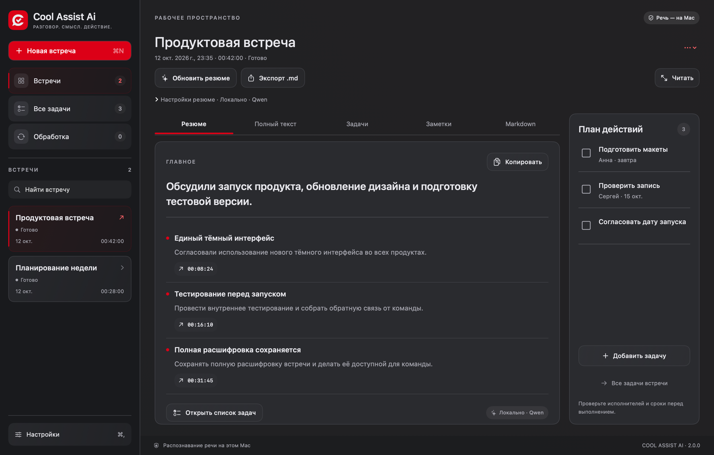

<p align="center">
  
</p>

<h1 align="center">Cool Assist Ai</h1>

<p align="center"><strong>От разговора — к понятному протоколу и действиям.</strong><br>macOS · Android · Windows · Linux</p>

<p align="center">
  <a href="#начало-работы">Начало работы</a> ·
  <a href="#установщики">Установка</a> ·
  <a href="#приватность-и-сохранность">Приватность</a> ·
  <a href="RELEASE-2.0.0.md">Проверки выпуска</a>
</p>

Запись встреч, полная расшифровка, резюме с темами и решениями, личные заметки и список задач. Спокойный графитовый интерфейс с акцентом `#d60000` и единым знаком диалога с галочкой.

- **Речь по ходу встречи.** Распознавание сохранённых фрагментов запускается во время записи.
- **Проверяемое резюме.** Темы, решения, вопросы и поручения со ссылками на исходные реплики.
- **Локальный AI на компьютере.** Whisper для речи и Qwen для текста; OpenAI API можно выбрать отдельно. На Android обработка облачная.
- **Несколько встреч в работе.** Просматривайте материалы, ведите заметки и задачи, пока другая встреча обрабатывается.
- **Полный Markdown.** В экспорт входят резюме и исходная расшифровка. Краткий итог не заменяет полный текст.



*Интерфейс macOS 2.0.0 на демонстрационной встрече. Данные на изображении вымышлены.*

## Установщики

| Платформа | Пакет 2.0.0 | Установка |
|---|---|---|
| macOS 15+, Apple Silicon | `CoolAssistAi-2.0.0-AppleSilicon.dmg` | Перенесите приложение в «Программы» |
| Android 10+ | `CoolAssistAi-Android-2.0.0.apk` | Откройте APK на телефоне |
| Windows 10/11 x64 | `Cool-Assist-Ai-2.0.0-win-x64.exe` | Запустите мастер установки |
| Debian / Ubuntu x64 | `Cool-Assist-Ai-2.0.0-linux-amd64.deb` | `sudo apt install ./Cool-Assist-Ai-2.0.0-linux-amd64.deb` |

Исходники находятся в Git. Собранные установщики и SHA-256 сохраняются в `dist/`, а не в истории репозитория. Для самостоятельной сборки используйте инструкции ниже. macOS-пакет не нотариализован Apple, Windows-пакет не имеет Authenticode-подписи; подробности приведены в [отчёте выпуска](RELEASE-2.0.0.md).

## Возможности платформ

| | macOS | Android | Windows / Linux |
|---|---|---|---|
| Распознавание | локальный Whisper, Metal | OpenAI API | локальный Whisper или OpenAI API |
| Резюме | локальный Qwen или OpenAI API | OpenAI API | локальный Qwen или OpenAI API |
| Запись без интернета | да | да | да |
| Речь по ходу записи | локально, фрагментами | фрагментами при наличии сети | локально или через API, фрагментами |
| Микрофон | да, отдельно от доступа к экрану | да | да |
| Звук приложений | ScreenCaptureKit, нужен доступ ОС | только разрешённый Android Playback Capture | Windows loopback; Linux — выбранный монитор аудиосистемы |
| Видео экрана | опционально | нет | нет |
| Экспорт | Markdown, полный текст | Markdown | Markdown |

Это отдельные нативные приложения macOS/Android и Electron-клиент Windows/Linux. Общая облачная синхронизация встреч между устройствами не реализована. Android не может универсально записывать телефонные звонки и звук приложений, запрещающих захват; разговор рядом с телефоном записывается микрофоном. У Windows системный захват охватывает звук всех приложений, а не одного выбранного собеседника.

## Начало работы

1. Установите пакет своей платформы. macOS: перенесите приложение из DMG в «Программы». Android: установите APK. Windows: запустите установщик EXE. Debian/Ubuntu: `sudo apt install ./Cool-Assist-Ai-*.deb`.
2. Выберите микрофон и разрешите его использование в системном запросе. На Mac режим «Только микрофон» работает без доступа к экрану. Для звука Mac отдельно разрешите запись экрана и системного аудио.
3. На Android добавьте собственный OpenAI API-ключ в настройках и разрешите облачную обработку. На Mac можно оставить полностью локальный режим. На Windows/Linux выберите «На этом компьютере» и нажмите «Скачать модели» (около 2,5 ГБ, один раз), либо выберите OpenAI и добавьте ключ. Подписка ChatGPT не включает расходы OpenAI API.
4. Укажите название встречи и начните запись. Виджет показывает фактический уровень звука; доступны пауза, отметка момента и завершение. Обработка продолжается в фоне, пока вы работаете с другой встречей.
5. Проверьте резюме, имена, числа и поручения по исходным репликам. Экспорт Markdown содержит полную расшифровку, а не только краткий итог.

Модели можно выбрать в настройках. Доступность, цена и поддержка структурированного ответа зависят от аккаунта OpenAI и выбранной модели. Автоматического перехода на более дорогую модель нет. Windows/Linux начинают с локального режима Whisper Small Q5 + Qwen3 4B Q4. Облачные модели по умолчанию — `gpt-4o-transcribe` для речи и `gpt-5.4` для резюме; название доступной модели можно ввести вручную.

## Приватность и сохранность

- Записи и промежуточные результаты хранятся локально. После сбоя сохранённые фрагменты можно обработать повторно. Обработка длинных встреч делится на ограниченные фрагменты и этапы.
- На Mac локальный режим не отправляет аудио и текст во внешние AI-сервисы. При выборе OpenAI для резюме отправляется текст встречи.
- Локальные модели Windows/Linux скачиваются с закреплённых ревизий Hugging Face, проходят проверку SHA-256 и далее работают без сети. На ПК используются CPU-движки whisper.cpp и llama.cpp, на Mac — Metal с резервным CPU-режимом. Скорость распознавания и резюме зависит от процессора и доступной памяти. Не происходит автоматического переключения в облако.
- В облачном режиме Android/Windows/Linux в OpenAI отправляются аудиофрагменты для распознавания и текст для резюме. На Windows/Linux личные заметки не входят в запросы.
- Ключи не включаются в исходники, экспорт или журналы. macOS использует Keychain, Android — Android Keystore. Electron использует защищённое хранилище ОС и отказывается сохранять ключ через небезопасный Linux `basic_text`; доступен режим до закрытия приложения.
- Аудиофайлы сами по себе не зашифрованы приложением. Используйте шифрование диска ОС и защищённую учётную запись.
- Удаление встречи выполняется из интерфейса; экспортированные отдельно файлы не удаляются автоматически.
- Предупреждайте участников о записи. Распознавание и AI-резюме могут ошибаться. Ссылки на исходные реплики помогают проверять выводы, но не доказывают смысловую безошибочность.

## Требования

- macOS 15+, Apple Silicon; локальные модели занимают несколько гигабайт. Рекомендуется 16 ГБ RAM для комфортной одновременной работы.
- Android: требования SDK указаны в `android/app/build.gradle.kts`; тестирование новых beta-версий Android требует отдельной проверки на устройстве.
- Windows 10/11 x64; Linux x64 с GTK 3, libgomp1, аудиосервером и доступным Secret Service для постоянного хранения ключа.
- Облачная обработка требует интернета и оплаченного доступа к выбранным моделям.

## Сборка macOS

Нужны Xcode Command Line Tools (Swift 6), Python 3.12+ и CMake. Скрипты скачивают закреплённые модели и runtime с проверкой SHA-256; они не хранятся в Git.

```sh
python3 scripts/fetch-dependencies.py
bash scripts/bootstrap-native.sh
swift run MeetingCoreChecks
bash scripts/test-app-model.sh
bash scripts/build-app.sh
bash scripts/package.sh --skip-build
```

Пакеты создаются в `dist/`. Внутренний bundle ID `cc.idomus.meet-secretar`, имя исполняемого файла и каталог данных сохранены для обновления существующих установок Meet Protocol без смены Keychain/TCC-идентичности.

По умолчанию скрипт создаёт постоянный личный сертификат в локальной Keychain. Это **не** Developer ID и **не** нотариализация Apple. Для распространения задайте `SIGN_IDENTITY` (Developer ID Application), при необходимости `INSTALLER_IDENTITY`, затем выполните нотариализацию своей учётной записью Apple. Не добавляйте сертификаты и приватные ключи в репозиторий. Изменение идентичности подписи может потребовать повторного предоставления разрешений macOS.

## Сборка Android

См. [Android README](android/README.md). Нужны JDK 17, Android SDK и Gradle Wrapper из проекта. Keystore и `signing.properties` остаются вне Git. Для обновления уже установленного приложения необходимо сохранить тот же ключ подписи и application ID.

## Сборка Windows / Linux

Нужны Node.js 22+, pnpm и зависимости Electron Builder. Установите точные зависимости из lock-файла:

```sh
cd desktop
python3 scripts/fetch-runtime.py all
pnpm install --frozen-lockfile
node node_modules/electron/install.js
pnpm test
pnpm build
pnpm package:win
pnpm package:linux
```

Пакеты: `dist/desktop/`. Нативные CPU-движки входят в установщик, модели загружаются пользователем отдельно в настройках. Загрузка runtime фиксирована по версии и SHA-256; Python 3.12+ требуется только для подготовки сборки. Рекомендуется собирать Windows на Windows, DEB на Linux. Для кросс-сборки NSIS может потребоваться Wine, для DEB — FPM/среда Linux. Windows-пакет без сертификата Authenticode не считается доверенным подписанным релизом. `COOL_ASSIST_TEST_DATA` позволяет задать изолированный каталог тестов только при запуске непакованного Electron-приложения.

## Проверки

- `swift run MeetingCoreChecks` — модель данных, аудиофрагменты, ссылки на реплики, экспорт и восстановление.
- `bash scripts/test-app-model.sh` — сценарии состояния нативного приложения.
- `python3 scripts/speech-worker-check.py` — реальный локальный ASR на публичной тестовой записи и тишине после сборки runtime.
- Android: unit tests, lint и instrumented tests через Gradle.
- Desktop: `pnpm test` и `pnpm build` (строгая проверка TypeScript и сборка).

Ускоренный тест длительности проверяет сохранность фрагментов, а не заменяет физическую трёхчасовую запись, сетевой тест OpenAI или проверку устройств. Детали подтверждённых проверок выпуска находятся в [RELEASE-2.0.0.md](RELEASE-2.0.0.md).

## Публичный репозиторий

В Git входят исходники, ресурсы бренда, тесты на синтетических/публичных данных и инструкции сборки. Записи встреч, локальные модели, сборки, API-ключи, `.env`, каталоги данных, keystore и сертификаты исключены. Перед публикацией выполняйте `python3 scripts/check-public-tree.py --staged`; крупные установщики следует хранить в релизах, а не в истории Git.

Документация используемых API: [OpenAI speech-to-text](https://developers.openai.com/api/docs/guides/speech-to-text), [Structured Outputs](https://developers.openai.com/api/docs/guides/structured-outputs), [Electron security](https://www.electronjs.org/docs/latest/tutorial/security). Лицензии моделей и нативных runtime находятся в `Resources/Licenses/` и включаются в macOS-пакет.
